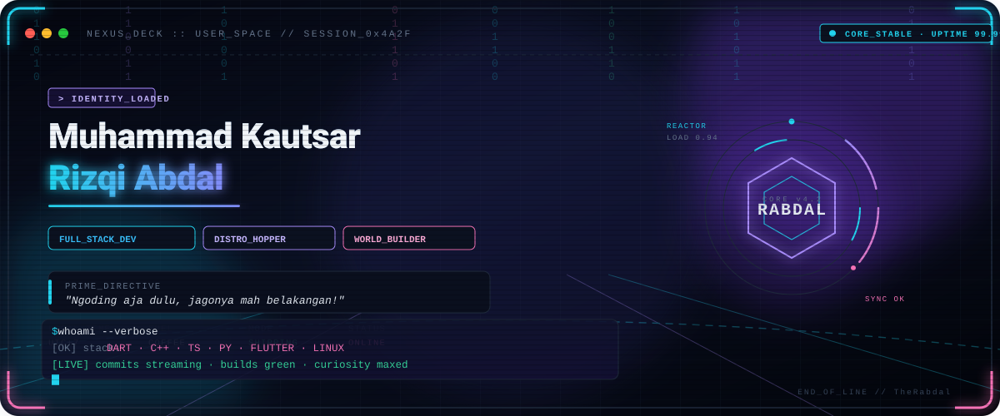

  

  <a href="#field-notes">FIELD NOTES</a> &nbsp;·&nbsp;
  <a href="#toolkit">TOOLKIT</a> &nbsp;·&nbsp;
  <a href="#activity">ACTIVITY</a> &nbsp;·&nbsp;
  <a href="#find-me">FIND ME</a>

 

> **“Ngoding aja dulu, jagonya mah belakangan!”**

## Field notes

| CURRENT MODE | APPROACH |
|:--|:--|
| Full-stack development | Learn by building, improve by iterating |
| Distro hopping | Always curious about what runs under the hood |

## Toolkit

  
<strong>01 / Languages</strong>

   
  
  
  
  
  
  

  
<strong>02 / Frameworks, platforms & data</strong>

   
  
  
  
  
  
  
  

  
<strong>03 / Tools & creative</strong>

   
  
  
  
  
  
  
  
  
  

## Activity

  
  
   
  

  

  

## Find me

  END OF TRANSMISSION · TheRabdal

