  

 

  <code>BOOT_SEQUENCE :: OK &nbsp;·&nbsp; CORE_SYNCED &nbsp;·&nbsp; AWAITING_NEXT_CHALLENGE</code>

 

> **“Ngoding aja dulu, jagonya mah belakangan!”**

---

### ◢ SYSTEM_MANIFEST ◣

<table>
  <tr>
    <td><b>USER_ID</b></td><td><code>TheRabdal</code></td>
    <td><b>ROLE</b></td><td><code>FULL_STACK_DEVELOPER</code></td>
  </tr>
  <tr>
    <td><b>CORE</b></td><td><code>LEARN_BY_BUILDING · ITERATE_TO_MASTERY</code></td>
    <td><b>MODE</b></td><td><code>SHIPPING</code></td>
  </tr>
  <tr>
    <td><b>DISTRO</b></td><td><code>ALWAYS_HOPPING</code></td>
    <td><b>UPTIME</b></td><td><code>99.99%</code></td>
  </tr>
</table>

---

### ◢ SKILL_MATRIX ◣

  

---

### ◢ MODULE_CONFIG ◣

---

### ◢ LIVE_METRICS_FEED ◣

  
  
   
  
   
  
   
  

---

### ◢ EXTERNAL_LINKS ◣

 

  END_OF_TRANSMISSION · TheRabdal · OS_REV_4.2 · NEXUS_ONLINE

